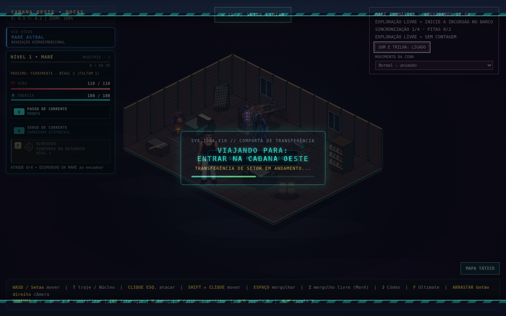
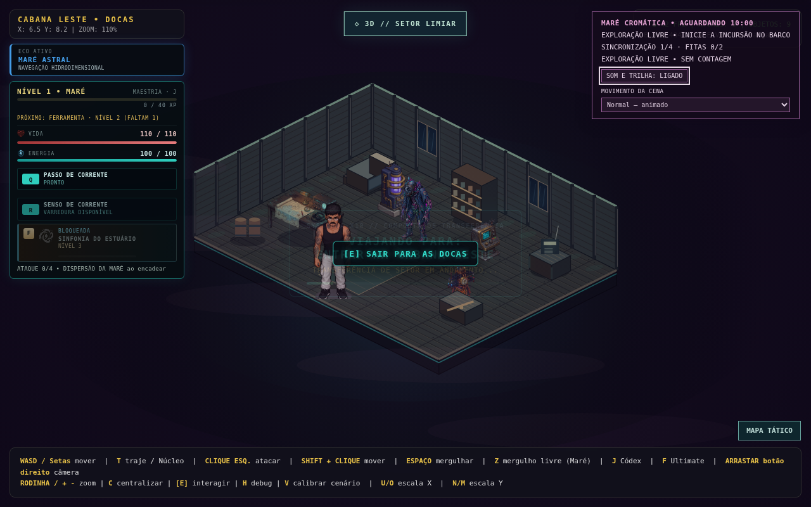
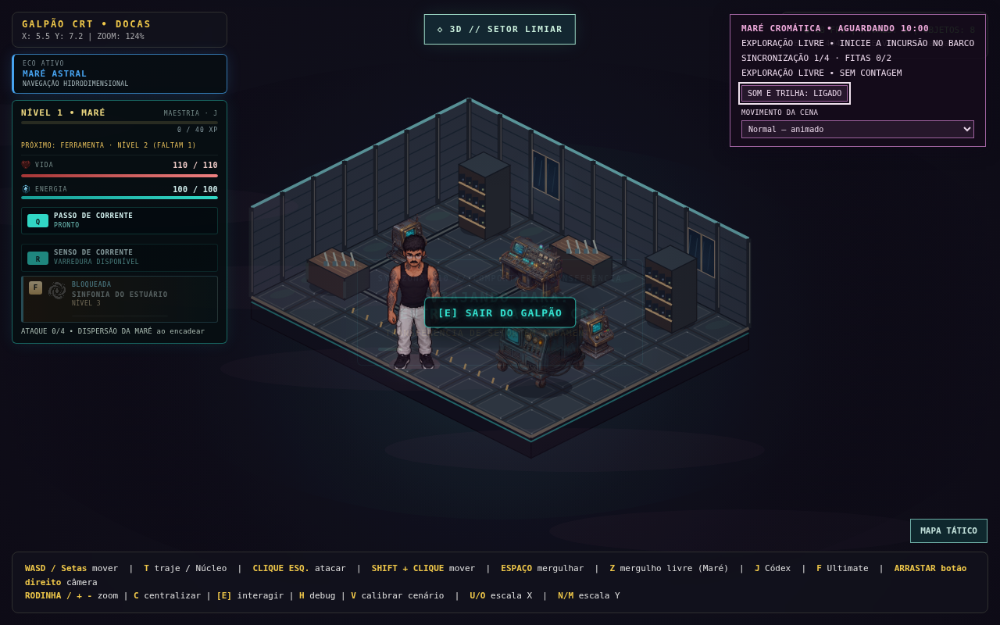

# Docas — segunda revisão de navegação, vegetação, interiores e som

## O que foi encontrado e corrigido

A primeira revisão conseguia alcançar os objetivos, mas isso não provava que as passagens visuais mais naturais estivessem boas. Esta revisão acrescenta testes de segmentos diretos de ida/volta, além da busca de conectividade.

- **Cais:** o polígono aproximado do acesso não correspondia à escada inteira. Agora o acesso usa `CAIS_SUL.escada.map(plantaCais)`, o mesmo registro que a planta do cais.
- **Escadaria:** redesenhadas somente as pegadas físicas das duas rampas e do patamar, seguindo os degraus e permitindo a curva. O caminho testado passa por `(980,420) → (1030,360) → (1105,298) → (1120,285) → (1075,262) → (1029,222) → (1015,180)` e volta.
- **Portal:** removida a faixa de navegação que descia pela frente da falésia; a ligação com o núcleo agora passa pelo passeio superior. Corrigida a entrada estreita junto ao console para permitir passar pela frente dele sem atravessar a máquina. Caminho direto testado: `(1000,180) → (1080,167) → (1100,179) → (1120,185) → (1180,200) → (1250,198)` e volta.
- **Bordas:** a checagem anterior amostrava 32 pontos no perímetro do corpo. Agora as arestas são divididas nas interseções e só a borda exposta da união dos pisos é mantida. A distância exata círculo/segmento bloqueia inclusive entalhes estreitos entre antigas sondas; emendas internas e sobreposições de patamares não viram paredes invisíveis. Cache montado uma vez por planta.
- Não foram alterados os controles, raio do jogador, subpassos de movimento, barcos, píer desenhado, fachadas, objetivos exteriores nem o fluxo dimensional.

Captura de diagnóstico atual: [exterior e colisões](../qa/docas-revisao-exterior.png). A prévia em `previa-docas-navegacao.html` continua disponível com WASD/setas e overlay.

## Vegetação realmente desenhada

As palmeiras traseiras estavam incorporadas a um bitmap estático; só animar sprites separados não as fazia mover. `docas-foliage.js` desenha agora a faixa superior das copas em 32 tiras com deslocamento gradual. Abaixo de y=238 da planta, a cabana/fundação é desenhada uma única vez, rígida. O teste compara os pixels: copas mudam, cabana e raízes não.

A oscilação das duas camadas vegetais oeste foi aumentada para ficar legível, assim como a palmeira do pátio. Mantêm-se os pés de ordenação por profundidade e o recorte local. Tudo usa o relógio visual existente; modo reduzido congela as transformações. Janelas, CRTs, farol, torre, cristais, mar, tentáculos/anéis e névoa existentes continuam ativos, sem adicionar duplicatas.

## Inventário dos acessos, um por um

### 1. Cabana oeste — abrigo dos pescadores

- Piso de tábuas com juntas, pregos, umidade e passadeira gasta.
- Paredes de madeira escura, janelas voltadas para o mar e luz fria de chuva.
- Cama, rede, bancada de reparos, estante, barris, mesa e baú: **7 móveis sólidos**.
- Bancada nova pintada, com cordame, ferramentas, caixa de pesca, rede e lampião âmbar.
- Fragmento da costa, fita da casa e chave da trilha mantidos. Saída e spawn mantidos.



### 2. Cabana leste — posto de escuta

- Tábuas esverdeadas/desgastadas, iluminação de vigia e passadeira distinta.
- Cama, rádio, mesa de cartas, estante, baú e barris: **6 móveis sólidos**.
- Mesa nova pintada com carta náutica, rádio analógico, fones, bússola e luminária de latão.
- Fragmento do acampamento, fita da vigília e fusível mantidos. Saída e spawn mantidos.



### 3. Galpão CRT — oficina de controle

- Piso de placas metálicas rebitadas, conduítes e marcações de segurança.
- Paredes de aço escuro, umidade e luz fria do mar.
- Dois racks, bancada, gerador e ferramentas: **5 móveis sólidos**.
- Gerador/carrinho diagnóstico novo pintado com ventilação, cabos, ferrugem, mostrador CRT e indicadores.
- Terminal de recompilação e dois gravadores de missão mantidos. Saída e spawn mantidos.



### Estruturas sem interior acessível

O farol, a cabana dos fundos, o abrigo oeste e o anexo do cais não possuem portas para novos mapas internos. O portal é uma estrutura exterior; sua ruptura final permanece intacta. A torre de vigia é explicitamente interditada pelo diálogo da escada destruída. Não foram inventados acessos nem removidas essas restrições narrativas.

## Arte e implementação

Um lote de **3 assets individuais**, sem necessidade de dez folhas: bancada, mesa de vigia e gerador. Originais em `assets/source-art/docas-interiores/`; sprites RGBA recortados em `assets/sprites/docas-interiores/`; processamento reproduzível com Pillow/NumPy em `tools/preparar-docas-interiores.py`.

Os demais móveis e materiais são desenhados proceduralmente. Os móveis entram na ordenação normal de objetos, com pegadas sólidas explícitas. As peças novas possuem fallback procedural se o sprite estiver indisponível. Não foram alterados IDs, regras ou textos dos objetos de missão. Desenho, luz e poeira não escrevem estado de jogo nem saves. As projeções internas usam `CONFIG.TILE_W/TILE_H`, não a projeção lateral externa das Docas.

## Som: manter a música, acrescentar tensão

A partitura existente foi preservada. A paisagem passa de cinco para sete canais:

- **Presságio:** metal friccionado/dissonância lenta, ressonâncias graves e eventos distantes esparsos. Sem gritos ou sustos de volume. Cresce sutilmente na proximidade do núcleo.
- **Interior:** mar abafado pelas tábuas, transformador CRT e gotas no telhado; a proporção muda por sala. A música recua a 78% do seu nível local nesses ambientes.
- Pequena cauda de convolução determinística, criada uma vez no opt-in. O impulso usa a taxa nativa do AudioContext — validado no Chromium real — e não exige arquivos ou serviços externos.
- Mantidos panorâmica, crossfades por gain, silêncio em pausa/aba oculta, botão de som opcional e reutilização das fontes/contexto. Nenhum autoplay. O controle de movimento reduzido também fica disponível dentro das salas.

## Validação e limites — não é uma suíte inteira verde

### Alterações desta revisão

- `docas-revisao-final.mjs`: três percursos exteriores diretos de ida/volta sem enrosco; rejeição de atalhos por água/falésia; união/colinearidade e entalhe estreito; **18 móveis sólidos**, **12 interações/saídas** internas alcançáveis; fallback sem sprites e Canvas balanceado; sete canais de som, sinais determinísticos finitos, amplitudes limitadas e silêncio ao pausar.
- `docas-navigation.mjs`: **12.383 arestas executadas pelo movimento real**, sete setores, todas as interações exteriores/portas e âncora final acessíveis.
- Chromium: entrada/saída real por **E** nos três interiores, após travessia com o motor de colisão; três sprites carregados; inventário, vida e energia preservados; um único AudioContext com opt-in, suspensão e retomada; nenhum erro de página/asset.
- Chromium navegação: copas traseiras mudam mais de mil pixels, a parte inferior permanece idêntica; vegetação oeste move e congela corretamente no modo reduzido; teclado e localStorage preservados.
- Ruptura real: terminal final → diálogo do Nulo → sequência → Limiar → Esc/2D passou, sem alterações de referências/vitais/resultado. Houve timeout de screenshot numa primeira execução carregada; a reexecução integral serial passou.

### Regressão ampla

- **230 suítes Node:** 207 passaram; **23 falhas existentes** reproduzidas em extração do HEAD-base, sem trocar de branch. Performance/relevo da praia rodaram serialmente.
- **22 suítes browser tentadas:** 18 passaram integralmente. `dimension-polish-browser` mantém uma falha de visibilidade do HUD X10 na linha 38, reproduzida identicamente na base. As capturas das galerias `dimension-master-morpher`, `dimension-sculpt` e `dimension-surgery` excederam o prazo no ambiente; seus testes funcionais passaram em diagnóstico separado com apenas `page.screenshot` desativado. Esses diagnósticos **não são contabilizados como passes integrais** das três suítes.
- As suítes browser diretamente relacionadas às Docas passaram, incluindo fidelidade, ausência de duplicação de construções, fallback de assets, gameplay/save/RAF, navegação, interiores e ruptura.
- `git diff --check` passou. Nenhum arquivo de `js/dimension/` foi modificado.

Falhas Node herdadas: `caminho-correntes`, `combat-basic`, `enseada-ecos`, `nado-desenho`, `docas-lote5/8/9/10/11/12/13`, `enseada-2-lote4/5/6/7/8/9/10`, `enseada-3-reference`, `enseada-4-lote`, `enseada-reconstrucao`, `limiar-frequencia`, `oceano-animado`.

## Reproduzir

```sh
node --experimental-default-type=module tests/docas-revisao-final.mjs
node --experimental-default-type=module tests/docas-navigation.mjs
node --experimental-default-type=module tests/docas-neblina.mjs
# Servir o repositório por HTTP (porta 8000 por padrão):
BROWSER_EXECUTABLE=/tmp/chromium \
PLAYWRIGHT_MODULE=$PWD/.qa/node_modules/playwright-core/index.mjs \
BROWSER_LIBRARY_PATH=/tmp/al2023/lib \
node --experimental-default-type=module tests/docas-interiores-browser.mjs
```
