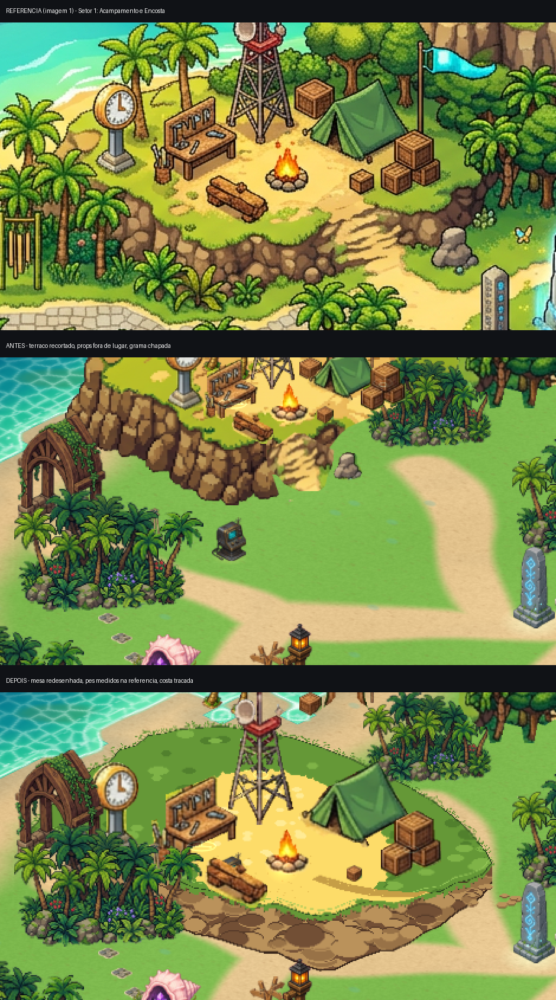

# Setor 1 — Acampamento e Encosta

Reconstrução do noroeste da **Enseada dos Ecos** (platô do acampamento, parede
de rocha e acesso por degraus), feita a partir da arte de referência
`assets/source-art/reparo-norte-10/referencia-mestre.png`.



## Achado que mudou o método

A arte mestre **não** está numa projeção "quase isométrica": ela usa a mesma
projeção e a mesma escala de tile do jogo. Desenhando a grade do mapa (`REF`)
por cima da referência, as diagonais encaixam exatamente:

```
px = 737.5 + 16 * (x - y)
py = -152.75 + 8 * (x + y)
```

Ou seja, **1 px de arte = 2 px de jogo**. Com isso, qualquer elemento medido na
referência entra no mapa sem correção de perspectiva — o que antes parecia
"desalinhamento de sprite" era, na verdade, um recorte em escala/projeção
erradas.

## O que mudou

### Costa

`tools/tracar-enseada-costa.py` separa mar de terra na referência (cor + flood
fill das bordas), isola a massa principal da ilha, fecha as enseadas estreitas
e suaviza a serrilha; o contorno é reamostrado a cada 8 px de arte (meio tile).
O resultado vai para `js/data/enseada-costa.js` (`POLIGONO` em tiles).

`enseada-ecos.js` passou a usar esse polígono no lugar do losango desenhado à
mão. A ilha deixou de ser uma elipse: agora tem as enseadas, os promontórios e o
recorte norte da arte.

Os recifes que a arte desenha soltos no mar (base do portal leste, promontório
do santuário, lajes do caminho das correntes, praia de desembarque do cais)
entram como ilhas próprias (`ILHAS_COSTA`) — é assim que a referência os
mostra, e as missões contam com eles em terra.

### Platô do acampamento

O `terraco-curto.png` (um recorte com moldura branca) foi substituído por uma
mesa desenhada em pixel art: `tools/desenhar-enseada-setor1.py`.

- **Por que desenhar:** os 10 equipamentos do acampamento cobrem exatamente o
  miolo do platô. Todo preenchimento automático daquele buraco (inpaint
  TELEA, PatchMatch-lite, Voronoi por classe, difusão ponderada, ray-vote)
  deixou cunhas e estrias. Desenhar dá alpha correto e resultado limpo.
- **Geometria medida, não inventada:** a face de cima é o polígono medido sobre
  a referência; a paleta é amostrada da própria arte (grama `#659837`, areia da
  clareira `#FDDC69`, rocha clara `#BA925B`, rocha escura `#72513A`…).
- O paredão desce da aresta **sul** (na projeção 2:1 a aresta norte esconde a
  parede atrás de si), com altura côncava e ondulada, e a grama avança sobre a
  rocha em linguetas — nada de aresta reta.

Peças geradas em `assets/sprites/enseada-norte/`:

| arquivo | uso |
| --- | --- |
| `plato-acampamento.png` | mesa completa — é a usada no mapa (`enseada_setor1_plato`) |
| `plato-topo.png` | só a superfície, para empilhar props |
| `plato-parede.png` | só o paredão |
| `plato-degraus.png` | degraus isolados |
| `medidas-setor1.json` | moldura, âncora em mundo, pivô, polígono |

A mesa entra como `camada: 'fundo'`: é o chão do setor, então desenha antes de
qualquer equipamento e nenhum prop é recoberto pela grama.

### Equipamentos

Os 10 equipamentos do acampamento passaram a usar os **pés medidos na
referência** (template matching com correlação 0,97–0,997 sobre as artes de
`assets/sprites/enseada-camp/`):

| objeto | x | y | largura |
| --- | --- | --- | --- |
| relógio de maré | 13.55 | 39.17 | 82 |
| bancada de campo | 16.14 | 37.20 | 122 |
| torre-antena | 15.64 | 33.58 | 110 |
| fogueira de vigília | 19.16 | 35.69 | 76 |
| tenda da expedição | 19.41 | 32.44 | 184 |
| pilha de caixas | 22.48 | 32.48 | 102 |
| banco de tronco | 19.48 | 38.73 | 106 |
| árvore do acampamento | 15.45 | 28.89 | 142 |
| cesto de ferramentas | 15.34 | 38.63 | 36 |

A ordenação por profundidade (`x + y`) e as hitboxes continuam acompanhando o
mesmo pé — nenhum `ajusteY` foi usado para "empurrar" sprite, então o jogador
passa na frente e atrás sem erro visual.

## Acesso ao acampamento

A arte **não** tem rampa comprida de areia: tem uma língua de areia entrando no
mar a nordeste e uma passagem de pedras (lajes) sobre a água. O mapa passou a
seguir isso — a língua de areia liga a costa norte às lajes, e as lajes são
piso caminhável **sobre água preservada** (`aguaPraia` continua marinha, então o
mar segue visível e nadável em volta).

## Verificação

Renderizador headless (`node tools/qa/render-enseada.mjs 1 out.png 0 0 --ref`)
na mesma projeção da arte, comparado pixel a pixel com a referência:

| | diferença média global | Setor 1 (230–690 × 140–400) |
| --- | --- | --- |
| antes | 58.44 | 62.5 |
| depois | **55.70** | **56.2** |

Também foi conferido que a máscara de terra do jogo agora cobre as células que
a arte mostra como terra, exceto um punhado de falsos positivos (palmeiras
desenhadas sobre a água, que a detecção por cor lê como terra).

Testes: a suíte terminava com 13 falhas na árvore limpa; agora termina com 11 —
duas falhas antigas foram corrigidas (`enseada-2-lote4`, `enseada-2-lote5`)
porque a âncora de "orla molhada" que elas procuravam estava numa célula que a
costa antiga marcava como areia e a nova (medida na arte) marca como areia seca.
Nenhuma falha nova.

## Como regerar

```bash
python3 -m venv .venv && .venv/bin/pip install pillow numpy opencv-python-headless matplotlib
.venv/bin/python tools/tracar-enseada-costa.py      # js/data/enseada-costa.js
.venv/bin/python tools/desenhar-enseada-setor1.py   # assets/sprites/enseada-norte/
npm install --no-save @napi-rs/canvas
node tools/qa/render-enseada.mjs 1 .qa/setor1.png 0 0 --ref
```
