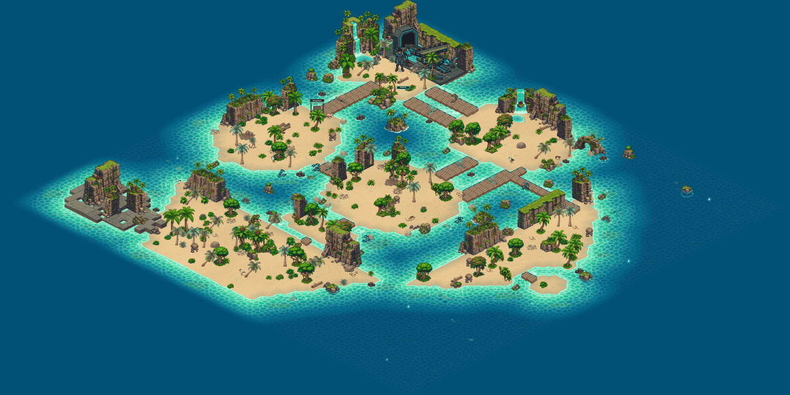
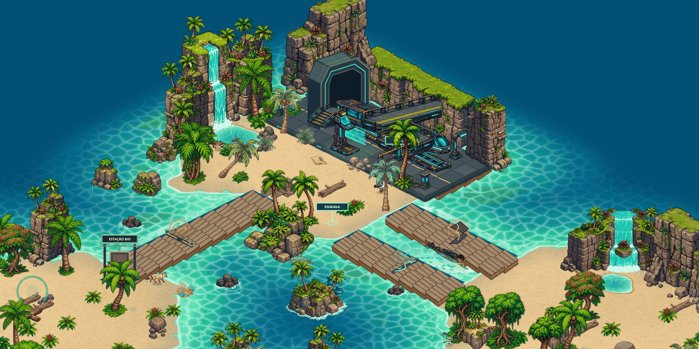

# Praia 11.0 — relevo, mar novo e a árvore de nado

A Praia 10.0 deixou o arquipélago grande e vivo, mas **plano**: areia, deque
e um mar que o operador atravessava de pé, deslizando, desde o primeiro
minuto. Esta rodada faz três coisas:

1. dá **altura** às ilhas (falésias, cascatas, arco de pedra, pilares);
2. refaz o **mar** (cor, luz, espuma, borda);
3. transforma o nado numa **progressão em 5 degraus** — começa-se com medo
   da água e termina-se dono do mar — e faz o corpo **nadar deitado**.

Como no documento da 10.0, aqui fica o que foi feito, o que foi medido e
**por que** cada decisão foi tomada.

---

## Estado por frente

| # | Frente | Estado | Prova |
|---|--------|--------|-------|
| 1 | Relevo das ilhas (12 peças de pedra) | **feito** | `tests/praia-relevo.mjs` |
| 2 | Flora nova (2 folhas 8×3) | **feito** | `tests/praia-relevo.mjs` |
| 3 | Mar: paleta, cáusticas, espuma, margem | **feito** | `tests/praia-performance.mjs`, `beach-surface.mjs` |
| 4 | Poças (água em cima da areia) | **feito** | `tests/praia-relevo.mjs`, `nado-arvore.mjs` |
| 5 | Árvore de nado (regra, provas, missão) | **feito** | `tests/nado-arvore.mjs` |
| 6 | Nado desenhado (corpo deitado, boias, marcador) | **feito** | `tests/nado-desenho.mjs` |
| 7 | Dicas de mergulho (fragmento, fauna) | **feito** | `tests/nado-desenho.mjs` |
| 8 | Desempenho (cache de sprites na escala da tela) | **feito** | `tests/nado-desenho.mjs` + medições abaixo |

Suíte ao final: **79 arquivos de teste, todos verdes.** Versão
`0.9.0-arquipelago`.

---

## 1. Relevo — a praia ganhou altura

Referência: `assets/source-art/praia-relevo/` (painel de ilha com paredões
de blocos cinzentos, topo de musgo, cascata com poço, palmeiras, bromélias
vermelhas, arco de pedra sobre lagoa turquesa).

**O que entrou**

- 12 peças em `assets/sprites/praia/relevo/`: `falesia-alta`, `falesia-muro`,
  `falesia-selva`, `macico-cascata`, `pilar-cascata`, `arco-pedra`,
  `pilar-palmeiras-a/b`, `pilar-samambaias`, `ilhota-palmeiras`,
  `rochas-mar`, `rochedo-pe` (+ 2 máscaras `-agua` das cascatas).
- 40 colocações no mapa: túnel do trem dentro de uma falésia alta, paredão
  atrás da estação, falésia oeste com cascata caindo na **Poça da Cascata**
  (Ilha A); maciço com cascata, falésia norte e arco de pedra (Ilha B);
  falésias, pilares, ilhotas e rochas com anel de espuma nas outras ilhas.
- Cascata animada (`js/engine/cascata.js`): fios de água recortados pela
  máscara da própria arte + respingo onde bate.
- **Costão** no Cabo: lajes de pedra desenhadas por cima das células `R` de
  fora do núcleo (`map.costao`).

**Decisões**

- **Relevo é OBJETO, não tile.** A grade aprovada (núcleo 48×48, com hash
  conferido em `tests/praia-maior.mjs`) não mudou uma letra. Cada peça é
  declarada com `relevo(id, peca, x, y, larguraPx, {...})` em
  `js/data/relevo-praia.js`, em coordenadas de mundo, com caixas de colisão
  próprias (`caixas`).
- **`larguraPx` manda** (regra herdada): nenhuma peça usa `scale`.
- **Pedra alta só em borda de trás.** Falésia na frente da ilha tapa o
  jogador e o chão; atrás, vira horizonte. Onde a peça é larga ela é
  desenhada em **tiras verticais**, cada uma com a sua profundidade, e o
  operador passa na frente de um trecho e atrás de outro.
- **Pedra nunca em cima de água sem base.** Falésia apoiada em célula de mar
  parece flutuar; `tests/praia-relevo.mjs` confere célula a célula.
- **Nada de caminho fechado.** O teste percorre os 24 430 pontos em que o
  operador cabe e exige que todos continuem alcançáveis; duas rochas que
  caíam em areia molhada foram movidas por causa dele.

Arte: `tools/preparar-relevo-praia.py` (recorta o magenta, mede a base de
cada peça e gera `js/data/relevo-praia-medidas.js`) e
`tools/preparar-flora-praia.py` (folhas `vegetacao-tropical-2` e
`costa-rochosa-2`, 8×3). A flora miúda é espalhada por `espalharFlora`, com
semente fixa: o mapa é o mesmo em todo carregamento.

---

## 2. Mar

| Distância da costa (tiles) | Cor |
|---|---|
| 0 | `rgb(150,240,204)` (lâmina clara) |
| 0,55 | `rgb(98,228,176)` |
| 1,7 | `rgb(34,190,152)` |
| 3,3 | `rgb(10,140,148)` |
| 5,4 | `rgb(3,104,136)` |
| 8 | `rgb(2,80,116)` → funde com `corFundo '#025074'` |

- **Cáusticas assadas na textura.** A primeira versão animava uma segunda
  tela de cáusticas por cima do mar: 18–23 ms por quadro. Agora a rede de luz
  é pintada uma vez junto com o mar (190–240 ms no carregamento, limite de
  350 ms no teste) e há **uma** passada animada opcional que se desliga
  sozinha quando o quadro passa de ~23 ms.
- **Margem de 5 tiles** (`MARGEM_MAR`): antes a textura acabava na borda da
  grade e o mar terminava numa linha reta. O campo de costa agora aceita
  `origem` e a textura é gerada além do mapa.
- Três linhas de espuma, manchas de recife e pedras com anel de espuma.

---

## 3. Poças — água em cima da areia

`map.pocas` são **zonas** (elipses), não células: `pocaEm(map, x, y)` em
`js/engine/pocas.js`. Duas no mapa: a **Poça da Cascata**
(centro 2,5 × 8,72; `treino: true`) e o Poço do Maciço na Ilha B.

Por que zona e não tile: a grade do núcleo é congelada, e uma poça é
redonda. Poça não tem correnteza, não tem limite de degrau e não assusta —
é a sala de aula.

---

## 4. Árvore de nado

Antes: qualquer operador entrava no mar aberto no primeiro minuto, descia ao
fundo sozinho e contornava nadando os gates das pontes. O mar não tinha
curva de aprendizado.

| Degrau | Nome | Alcance (tiles da areia) | Mergulho | Ar | Velocidade | Arrancada |
|---|---|---|---|---|---|---|
| 0 | MEDO DA ÁGUA | 0,9 (só molha o pé) | — | — | 0,50 | não |
| 1 | BOIAR | 1,45 | só a cabeça | 5 s | 0,62 | não |
| 2 | FÔLEGO | 4,5 | raso (1,2) | 9 s | 0,80 | sim |
| 3 | TRAVESSIA | mar inteiro | fundo (2,0) | 13 s | 0,92 | sim |
| 4 | MARÉ PLENA¹ | mar inteiro | fundo (2,0) | 22 s | 1,00 | sim |

¹ Para o arquétipo Maré Astral o degrau 4 se chama **MARÉ ASTRAL** e rende
mais: ar ×1,3 (51 s com respeito cheio), correnteza contrária pela metade e
respeito ×1,5. O nado nunca passa da velocidade de caminhada (regra da 10.0).

**Provas** (uma por degrau; o progresso fica no save):

1. **Boiar** — 3 s parado dentro de uma poça.
2. **Respirar** — 4 s seguidos com a cabeça na água (`ESPAÇO`), vale na poça.
3. **Travessia** — sair de uma ilha, nadar ≥ 6 tiles e pisar em outra.
4. **Fundo** — 1,2 s mergulhado onde o fundo passa de 1,9.

**Controles:** `ESPAÇO` segurado = mergulhar. `SHIFT` = arrancada. Com a
árvore o corpo fica na superfície e só desce com o gesto.

**O que acontece no limite**

- Degrau 0 no mar: o operador recua para a areia e leva 3 de dano
  (`O MAR ASSUSTA • TREINE NA POÇA DA CASCATA`).
- Além do alcance do degrau: recua, sem dano, e o aviso diz qual é a prova.
- Ar acabou: o corpo **sobe sozinho** engolindo água (6 de dano, uma vez),
  em vez de afogar quadro a quadro.
- O limite não é parede invisível: nos degraus 1 e 2 ele é um **cordão de
  boias** (contorno "distância da areia = alcance", por *marching squares*),
  que só aparece perto do operador.

**Missão** `aprender_a_nadar` (secundária, 70 XP + 1 ponto + Boia de
Cortiça): abre sozinha na primeira praia. O painel no canto inferior
esquerdo mostra o degrau e a prova em curso; o Códex ganhou o cartão
**ÁRVORE DE NADO**. A recompensa começou em 160 XP e caiu para 70 depois do
teste no navegador: 160 levava o operador do nível 1 ao 4 de uma vez e
destravava a Ultimate por tabela.

**Saves antigos:** quem já mergulhou (tem fragmento, progresso em
`mare_profunda` ou bicho curado) herda o degrau 4 e não recebe aula.

### Lições desta frente (bugs que os testes e o navegador pegaram)

- **Vão na beira d'água (bug antigo).** Andar exige o raio inteiro em terra
  e nadar exige o centro na água: sobrava uma faixa de 0,25 tile que o passo
  de um quadro não atravessava. Entrar andando no mar parava em x = 13,70.
  Corrigido com `naBeira` em `collision.js`.
- **`nado.ativo` é falso na franja da praia** (a profundidade é 0 no primeiro
  meio tile de água). Medo, alcance e travessia são decididos **pela
  célula**, nunca por `nado.ativo`.
- **Trava de ponte virava parede no mar.** A caixa de um gate sobra meio tile
  para cada lado do deque; para quem nada, era uma parede invisível no meio
  do canal (a prova de travessia parava em 3,9 de 6 tiles). Na água a trava
  não bloqueia mais — quem está na água não está no deque.
- **O campo de costa conta deque como terra**, então a água entre as duas
  pontes parecia rasa. O alcance usa um campo próprio de distância da
  AREIA.
- **Teleporte não é travessia** (saltos > 1,5 tile zeram a prova) e andar
  pelo deque desconta.
- **O aviso do centro da tela nunca esteve no centro**: `#hudLeft > *`
  zerava `left`/`bottom` com `!important` e o texto ficava cortado no canto
  de cima. Corrigido no CSS.

---

## 5. O nado aparece

`js/engine/nado-desenho.js` + cinco folhas em
`assets/sprites/player/nado-<traje>.png` (680×120, dois quadros, corpo
horizontal de perfil; `tools/preparar-nado.py`).

- **Uma folha por traje**: civil, Maré, Bio-Forja, Domínio e Núcleo (as
  formas do Núcleo nadam com o traje do Núcleo).
- **Um corpo, todas as direções**: o corpo gira para o rumo do nado na tela
  (ângulo isométrico), espelha quando aponta para a esquerda e encurta um
  pouco quando nada "para cima/baixo" (escorço). Uma folha por direção
  seria 8× mais arte para o mesmo resultado.
- **Ondulação em 10 fatias** (a cauda bate mais que a cabeça), dois quadros
  de braçada na cadência da velocidade.
- **Linha d'água**: a parte de baixo do corpo é translúcida. Mergulhado, o
  corpo inteiro esmaece, solta bolhas e não deixa esteira; na superfície
  deixa esteira de espuma e sombra no fundo. Arrancada risca a água na cor
  do traje.
- **Âncora no peito, não no meio do corpo**: a cabeça avança pouco sobre a
  areia ao chegar na praia.
- **Histerese** entre em pé e deitado: na franja da praia o estado liga e
  desliga a cada passo, e o corpo piscava.
- Atacando, usando habilidade ou Ultimate na água, o operador usa a arte de
  pé (ele se ergue para golpear).

Tamanho: com a primeira escala (0,28) o nadador tinha metade da altura do
operador em pé — parecia uma criança. Ficou em 0,42 (≈ 100 px da cabeça aos
pés, contra ≈ 120 px em pé).

---

## 6. Cabeça na água × corpo no fundo

Com o mergulho virando gesto, "estar submerso" deixou de ser uma coisa só
(`js/game/nado.js`):

| Pergunta | Função | Quem usa |
|---|---|---|
| A cabeça está na água? | `cabecaSubmersa(nado)` | raios de sol, cardumes, **socorro de bicho aquático** |
| O corpo está lá embaixo? | `noFundoDoMar(nado)` | fragmentos de maré, mergulhos da missão, respeito |

Bicho no raso se socorre no raso (degrau 1 já serve); fragmento fica no
azul-escuro e pede o degrau TRAVESSIA.

E o jogo **avisa** quando só falta o gesto: boiando em cima de um fragmento
aparece `FRAGMENTO NO FUNDO • SEGURE ESPAÇO PARA MERGULHAR` (ou `FALTA O
DEGRAU TRAVESSIA`); perto de um bicho aquático com o módulo certo,
`SEGURE ESPAÇO PARA MERGULHAR • <BICHO>`. Sem isso o jogador ficava em cima
do cristal sem saber por que não pegava.

---

## 7. Desempenho

Medido no Chrome sem GPU (canvas por software, 1600×900) — o **pior caso**:
numa máquina com aceleração os números são várias vezes maiores. Serve para
comparar antes e depois, não como promessa de FPS.

O perfil mostrou que reduzir sprite com filtro a cada quadro era o item mais
caro: 349 objetos custavam 25 ms de 58. Agora, com o zoom parado, cada
recorte é reduzido **uma vez** e depois só copiado, alinhado ao pixel da
tela (`SPRITES JÁ NA ESCALA DA TELA`, em `renderer.js`).

| Vista | Antes do cache | Depois |
|---|---|---|
| Ilha A, zoom 1 | 17,3 FPS | **25,2** |
| Canal, nadando com boias | 14,3 | **18,8** |
| Mapa inteiro, zoom 0,3 | 24,3 | **33,6** |
| Ilha B, zoom 0,75 | 17,0 | **23,6** |
| Ilha A, zoom 2 | 12,4 | **16,0** |

O cache ocupa de 0,6 a 20 MB conforme o zoom (teto de 96 MB), é construído
aos poucos (10 peças por quadro) e é descartado quando o zoom muda. Peça com
filtro de estado, `skewY` ou `escalaY` continua no caminho direto.

Custo do nado por quadro: 20 `drawImage` pequenos + até ~14 elipses de
esteira; boias só as próximas do operador. Nada cresce com o mapa.

**Honesto:** a referência de 60 FPS da 10.0 não foi medida em máquina com
GPU nesta rodada. Se a praia pesar em algum computador, o próximo alvo é o
piso (`drawFloorSprite` ainda reduz com filtro a cada quadro).

---

## Pendências

- **Domínio nadando** tem os dois quadros iguais (a segunda geração da arte
  veio idêntica): o corpo ondula, mas o braço não alterna.
- O **costão** do Cabo ainda lê como laje plana.
- Corpo deitado é comprido: perto de um deque a mão passa por cima das
  tábuas.
- `fauna-ferida.js` procura areia com letras minúsculas (`'s'`/`'b'`) e por
  isso bicho de terra nasce em deque. Bug anterior a esta rodada, não
  corrigido.
- Quem chega a outra praia (Enseada, Estação Bio) no degrau 0 precisa voltar
  à Praia Inicial para treinar: só ela tem poça. O aviso diz isso.
- Nadar a partir do degrau 2 contorna os gates das pontes, como já acontecia
  antes da árvore. Se os gates precisarem valer também na água, o lugar é
  `aguaDoDegrau` em `nado.js`.

---

## Onde mexer daqui pra frente

| Quero… | Arquivo |
|--------|---------|
| mover/adicionar pedra | `praia-inicial.js` (`RELEVO_*`) com `relevo()` de `js/data/relevo-praia.js` |
| nova peça de relevo | PNG magenta em `assets/source-art/praia-relevo/` → `tools/preparar-relevo-praia.py` |
| cor do mar, espuma | `js/engine/beach-water.js` (rampa, `MARGEM_MAR`) |
| nova poça | `POCAS` em `praia-inicial.js` |
| números de um degrau | `DEGRAUS` em `js/game/nado-arvore.js` |
| nova prova | `PROVAS` + `atualizarProvas` em `js/game/nado-arvore.js` |
| tamanho/ondulação do nadador | `ESCALA`, `FATIAS` em `js/engine/nado-desenho.js` |
| folha de nado de um traje | `assets/source-art/nado/` → `tools/preparar-nado.py` |
| orçamento do cache de sprites | `ESCALADOS_*` em `js/engine/renderer.js` |

Ao mexer em qualquer um destes, **rode a suíte inteira**.
